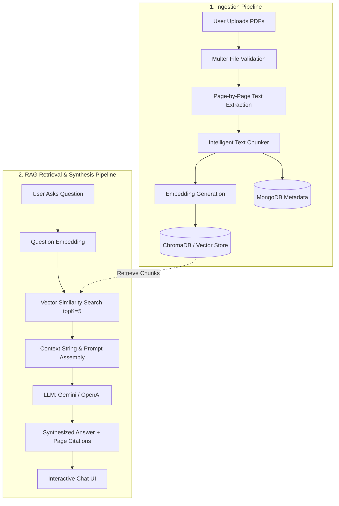

# 📄 Multi-PDF RAG System

A production-ready, full-stack **Retrieval-Augmented Generation (RAG)** platform designed to ingest, chunk, embed, and query multiple PDF documents simultaneously. The system preserves page-level tracking throughout the pipeline, enabling **exact page-number source citations** for every generated answer.

Built with a modular vector database architecture (defaulting to **ChromaDB** with built-in persistent fallback), **Node.js/Express**, **MongoDB**, **React 19**, **Tailwind CSS**, and modern AI LLM integration (**Google Gemini** & **OpenAI**).

---

## 🌟 Key Features

### 📑 Document Processing Pipeline
- **Multi-PDF Drag & Drop**: Upload multiple PDFs simultaneously with client & server-side validation (MIME type and 20MB file limit).
- **Page-Preserving Extraction**: Uses Mozilla-grade PDF parsing to extract page-by-page text without merging boundaries.
- **Intelligent Chunking**: Recursive sentence- and paragraph-aware chunking (default 1000 characters with 150-character overlap) retaining `documentId`, `userId`, `filename`, `pageNumber`, and `chunkId`.
- **One-Time Embedding**: Chunks are embedded during ingestion, not at query time.
- **Asynchronous Background Workers**: Files upload instantly and process asynchronously with live status tracking (`Uploading` ➔ `Processing` ➔ `Embedding` ➔ `Ready` / `Failed`).

### 🧠 Semantic Search & RAG Chat
- **Semantic Vector Retrieval**: Performs cosine similarity search across indexed document embeddings with configurable `topK` (default 5).
- **Exact Source & Page Citations**: Every answer includes clickable citation cards referencing `📄 Filename.pdf — Page X` and specific chunk IDs.
- **Citation Inspection Modal**: Click any citation to inspect the retrieved text excerpt or open the original PDF in your browser.
- **Multi-Turn Conversation Memory**: Maintains context across follow-up questions within each chat session.
- **Configurable LLM Dispatcher**: Seamlessly switch between Google Gemini (`gemini-1.5-flash`), OpenAI (`gpt-4o-mini`), Groq, or the built-in offline contextual synthesizer.
- **Markdown & Code Rendering**: Full markdown formatting, lists, tables, and formatted code blocks with copy-to-clipboard functionality.

### 🛡️ Security & Enterprise Architecture
- **JWT Authentication**: Secure user registration, login, and protected endpoints with bcrypt password hashing.
- **Multi-Tenant Isolation**: Users can only query, view, and delete their own documents and chat sessions.
- **Cascade Vector Deletion**: Deleting a document removes its MongoDB record, disk file, and all associated vectors from ChromaDB.
- **Modular Vector Store Interface**: Easily swap between ChromaDB, Pinecone, or the built-in persistent local vector store.

---

## 🏗️ Architecture & RAG Workflow



### Complete RAG Workflow Steps:
1. **PDF Upload**: User uploads documents via drag-and-drop.
2. **Text Extraction**: Text is extracted per page while strictly preserving the 1-indexed page number.
3. **Chunking**: Text is split into overlapping chunks, each tagged with `documentId`, `userId`, `filename`, `pageNumber`, and `chunkId`.
4. **Embedding**: Dense embeddings (e.g., Gemini `text-embedding-004` or OpenAI `text-embedding-3-small`) are generated once.
5. **Vector Store**: Vectors and rich metadata are saved to ChromaDB.
6. **Query Retrieval**: The user's query is converted to an embedding and compared against stored chunks.
7. **Synthesis**: The top-$K$ chunks and conversation history are combined into the system prompt.
8. **Citation Response**: The LLM answers strictly using context, returning citations with filename and page numbers.

---

## 🛠️ Tech Stack

| Layer | Technologies |
| :--- | :--- |
| **Frontend** | React 19, Vite 8, Tailwind CSS, React Router v7, Axios, Lucide React, React Markdown, Remark GFM |
| **Backend** | Node.js (ESM), Express.js 4, Multer, JWT, BcryptJS, Unpdf, PDF-Lib |
| **Vector Database** | ChromaDB (`chromadb` client) + Persistent Local Cosine Vector Store |
| **Primary Database** | MongoDB (Mongoose ODM) |
| **AI / LLMs** | Google Gemini (`@google/generative-ai`), OpenAI (`openai`), Local Synthesizer |

---

## 📁 Project Structure

```text
multi-pdf-rag/
├── client/                     # Frontend Application (React + Vite + Tailwind)
│   ├── src/
│   │   ├── components/
│   │   │   ├── chat/           # ChatInput, MessageItem, SourceCitation, SourcePreviewModal
│   │   │   ├── documents/      # FileUploadModal, DocumentDetailsModal
│   │   │   ├── layout/         # AppLayout, Sidebar, Header, ProtectedRoute
│   │   │   └── ui/             # Button, Badge, Modal, Skeletons
│   │   ├── context/            # AuthContext, ToastContext
│   │   ├── pages/              # Login, Register, Dashboard, Documents, Chat, History, Profile
│   │   ├── services/           # Axios API client with JWT interceptor
│   │   ├── utils/              # Formatters (bytes, dates, relative time)
│   │   ├── App.jsx             # React Router setup
│   │   ├── main.jsx            # React root
│   │   └── index.css           # Modern Tailwind theme & glassmorphism
│   ├── package.json
│   ├── tailwind.config.js
│   └── vite.config.js
│
├── server/                     # Backend Application (Node.js + Express)
│   ├── src/
│   │   ├── config/             # Environment variables (env.js) and MongoDB connection (db.js)
│   │   ├── controllers/        # authController, documentController, chatController, healthController
│   │   ├── middleware/         # auth (JWT), upload (Multer PDF filter), errorHandler
│   │   ├── models/             # User, Document, ChatSession Mongoose models
│   │   ├── routes/             # authRoutes, documentRoutes, chatRoutes, healthRoutes
│   │   ├── services/
│   │   │   ├── pdf/            # extractor.js (page-preserving), chunker.js
│   │   │   ├── embeddings/     # embeddingService, geminiProvider, openaiProvider, localProvider
│   │   │   ├── vector/         # vectorStoreInterface, chromaVectorStore, localVectorStore
│   │   │   └── rag/            # promptTemplates, llmService, ragPipeline
│   │   ├── utils/              # logger, response helpers
│   │   └── server.js           # Main Express server entrypoint
│   ├── tests/                  # End-to-end automated test suite (api.test.js)
│   └── package.json
│
├── uploads/                    # Local storage for uploaded PDF files
├── vector_db/                  # Persistent storage directory for vector index
├── .env.example                # Sample environment variables
├── .gitignore
├── package.json                # Root package for concurrently running client & server
└── README.md
```

---

## ⚙️ Environment Variables

Create a `.env` file in the root directory (or copy `.env.example`):

```env
# Server Configuration
PORT=5000
CLIENT_URL=http://localhost:5173

# MongoDB Connection
MONGODB_URI=mongodb://localhost:27017/multi_pdf_rag

# JWT Configuration
JWT_SECRET=super_secret_jwt_key_multi_pdf_rag_2025_secure
JWT_EXPIRES_IN=7d

# LLM Configuration ('gemini', 'openai', 'groq', 'local')
LLM_PROVIDER=gemini
LLM_API_KEY=your_gemini_or_openai_api_key_here
LLM_MODEL=gemini-1.5-flash

# Embeddings Configuration ('gemini', 'openai', 'local')
EMBEDDING_PROVIDER=gemini
EMBEDDING_API_KEY=your_gemini_or_openai_api_key_here
EMBEDDING_MODEL=text-embedding-004

# Vector DB Configuration ('chroma', 'local', 'chroma-fallback')
VECTOR_STORE_PROVIDER=chroma-fallback
CHROMA_URL=http://localhost:8000
CHROMA_COLLECTION=pdf_documents

# Chunking & RAG Parameters
MAX_FILE_SIZE=20971520
CHUNK_SIZE=1000
CHUNK_OVERLAP=150
TOP_K=5
```

---

## 🚀 Running Locally

### Prerequisites
- **Node.js** >= 18 (Tested on Node.js v26)
- **MongoDB** running locally on port 27017 or a MongoDB Atlas connection string.
- *(Optional)* **ChromaDB** running on port 8000 (if omitted, the system seamlessly uses the local vector store).

### 1. Install Dependencies
Run from the root directory:
```bash
npm run install:all
```
*(Or install in each directory individually)*:
```bash
cd server && npm install
cd ../client && npm install
```

### 2. Run Backend & Frontend Concurrently
From the root directory:
```bash
npm run dev
```

Alternatively, run in separate terminals:
```bash
# Terminal 1: Backend (Port 5000)
cd server
npm run dev

# Terminal 2: Frontend (Port 5173)
cd client
npm run dev
```

### 3. Open in Browser
Visit **[http://localhost:5173](http://localhost:5173)** to open the application.

---

## 🧪 Automated Testing

The backend includes a comprehensive automated test suite verifying all 12 key capabilities:
- Health check & database connection
- User registration & JWT generation
- User login with bcrypt verification
- Protected routes authentication
- PDF upload & page-by-page extraction
- Chunker & metadata validation
- Vector indexing
- RAG question answering with exact page citations
- Chat history sessions
- Dashboard statistics
- Document deletion and vector cleanup

To run the test suite:
```bash
cd server
npm test
```

Expected result:
```text
✔ GET /api/health should return healthy status
✔ POST /api/auth/register should register new user
✔ POST /api/auth/login should authenticate user
✔ GET /api/auth/me should return authenticated user profile
✔ GET /api/documents should reject unauthenticated requests
✔ POST /api/documents/upload should upload and parse PDF with page numbers
✔ GET /api/documents/:id should show Ready status with page count 2
✔ POST /api/chat should answer question and cite document and page number
✔ GET /api/chats/:id should retrieve conversation history
✔ GET /api/stats should return aggregated dashboard statistics
✔ DELETE /api/documents/:id should delete document and vector records
✔ Multi-PDF RAG System - End-to-End Test Suite (pass 12, fail 0)
```

---

## 📡 API Reference

### Authentication
- `POST /api/auth/register` - Create a new user account.
- `POST /api/auth/login` - Authenticate and receive JWT.
- `GET  /api/auth/me` - Get authenticated user profile.
- `PUT  /api/auth/preferences` - Update personal LLM provider/key.

### Documents
- `POST   /api/documents/upload` - Upload up to 10 PDFs (`multipart/form-data`).
- `GET    /api/documents` - List all user documents with pagination and status filters.
- `GET    /api/documents/:id` - Get document details and chunk metadata.
- `GET    /api/documents/:id/file` - Stream/view the PDF document in browser.
- `DELETE /api/documents/:id` - Delete document, disk file, and vector embeddings.

### RAG Chat
- `POST   /api/chat` - Query documents via RAG (returns answer + sources).
- `GET    /api/chats` - List user chat sessions.
- `GET    /api/chats/:id` - Get messages and citations for a chat session.
- `PATCH  /api/chats/:id` - Rename chat title.
- `DELETE /api/chats/:id` - Delete chat session.

### Health & Stats
- `GET /api/health` - Check database, vector store, and LLM status.
- `GET /api/stats` - Get aggregated dashboard metrics.

---

## 📄 License
MIT License. Created for production RAG applications.
# Multi_pdf_rag_system

