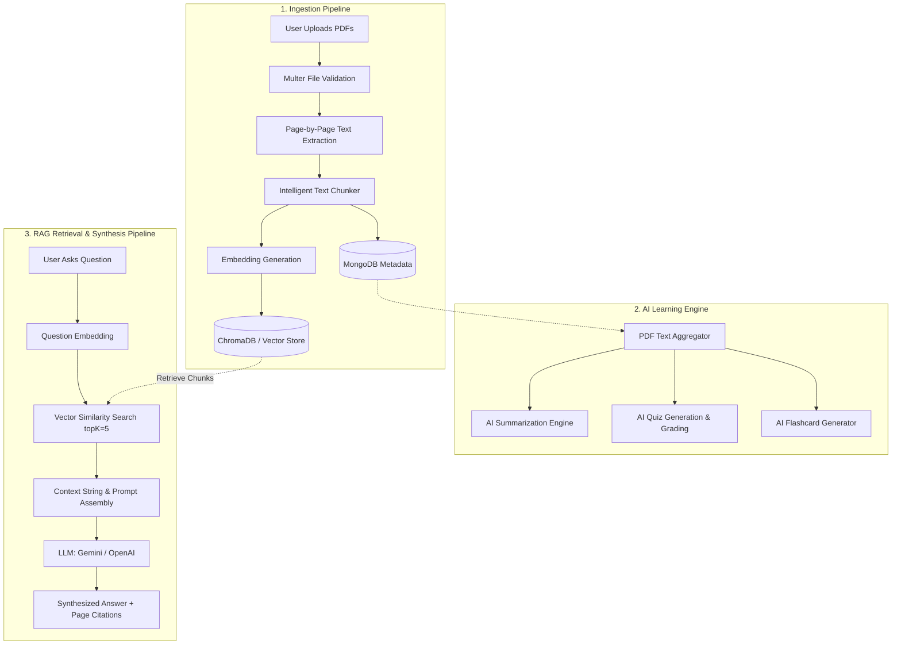

# 📄 Multi-PDF RAG & AI Learning Platform

A production-ready, full-stack **Retrieval-Augmented Generation (RAG)** and intelligent study platform designed to ingest, chunk, embed, query, and transform multiple PDF documents simultaneously. The system preserves page-level tracking throughout the entire pipeline, enabling **exact page-number source citations** for questions, summaries, quizzes, and flashcards.

Built with a modular vector database architecture (defaulting to **ChromaDB** with built-in persistent fallback), **Node.js/Express**, **MongoDB**, **React 19**, **Tailwind CSS**, and modern AI LLM integration (**Google Gemini** & **OpenAI**).

---

## 🌟 Key Features

### 📑 Document Processing Pipeline
- **Multi-PDF Drag & Drop**: Upload multiple PDFs simultaneously with client & server-side validation (MIME type and 20MB file limit).
- **Page-Preserving Extraction**: Uses Mozilla-grade PDF parsing to extract page-by-page text without merging boundaries.
- **Intelligent Chunking**: Recursive sentence- and paragraph-aware chunking (default 1000 characters with 150-character overlap) retaining `documentId`, `userId`, `filename`, `pageNumber`, and `chunkId`.
- **One-Time Embedding**: Chunks are embedded during ingestion, not at query time.
- **Asynchronous Background Workers**: Files upload instantly and process asynchronously with live status tracking (`Uploading` ➔ `Processing` ➔ `Embedding` ➔ `Ready` / `Failed`).

### 🧠 Semantic Search & RAG Chat
- **Semantic Vector Retrieval**: Performs cosine similarity search across indexed document embeddings with configurable `topK` (default 5).
- **Exact Source & Page Citations**: Every answer includes clickable citation cards referencing `📄 Filename.pdf — Page X` and specific chunk IDs.
- **Citation Inspection Modal**: Click any citation to inspect the retrieved text excerpt or open the original PDF in your browser.
- **Multi-Turn Conversation Memory**: Maintains context across follow-up questions within each chat session.
- **Configurable LLM Dispatcher**: Seamlessly switch between Google Gemini (`gemini-1.5-flash`), OpenAI (`gpt-4o-mini`), Groq, or the built-in offline contextual synthesizer.
- **Markdown & Code Rendering**: Full markdown formatting, lists, tables, and formatted code blocks with copy-to-clipboard functionality.

### 🎓 AI-Powered Learning Features
1. **AI PDF Summarization (`/summarize`)**:
   - **Short Summary**: Quick executive overview with main ideas and core takeaways.
   - **Detailed Summary**: In-depth explanation covering technical terms, methodologies, and examples.
   - **Chapter-wise Summary**: Structured breakdown preserving document headings and page ranges.
   - **Key Points**: High-yield bullet points, core definitions, and formulas.
   - **Actions**: Copy to clipboard, download as TXT or printable PDF, save to history.
2. **AI Quiz Generator (`/quiz`)**:
   - **Question Types**: Multiple Choice (MCQ), True/False, Mixed.
   - **Question Counts**: 5, 10, 15, or 20 questions.
   - **Interactive Player**: Single-question view with timer, progress bar, instant feedback, and answer justifications citing source page numbers.
   - **Score Analytics**: Percentage calculation, pass/fail status, answer review, and instant retake option.
3. **AI Flashcards (`/flashcards`)**:
   - **Interactive 3D Flip Card**: Click or press <kbd>Space</kbd> to flip between term and answer with source doc & page citations.
   - **Study Tracking**: "Mark Known" vs. "Need Practice" status tagging.
   - **Study Tools**: Shuffle cards, restart deck, filter by practice mode, and rename sets.
4. **Centralized Learning History (`/history`)**:
   - 4 searchable category tabs: AI Chats, Summaries, Quizzes, and Flashcard Sets.
   - Real-time search across titles, document sources, and tags.

### 🛡️ Security & Enterprise Architecture
- **JWT Authentication**: Secure user registration, login, and protected endpoints with bcrypt password hashing.
- **Multi-Tenant Isolation**: Users can only query, view, and delete their own documents, chats, summaries, quizzes, and flashcards.
- **Cascade Vector Deletion**: Deleting a document removes its MongoDB record, disk file, and all associated vectors from ChromaDB / Local vector store.
- **Modular Vector Store Interface**: Easily swap between ChromaDB and the built-in persistent local vector store.

---

## 🏗️ Architecture & RAG Workflow



---

## 🛠️ Tech Stack

| Layer | Technologies |
| :--- | :--- |
| **Frontend** | React 19, Vite 8, Tailwind CSS, React Router v7, Axios, Lucide React, React Markdown, Remark GFM |
| **Backend** | Node.js (ESM), Express.js 4, Multer, JWT, BcryptJS, Unpdf, PDF-Lib |
| **Vector Database** | ChromaDB (`chromadb` client) + Persistent Local Cosine Vector Store |
| **Primary Database** | MongoDB (Mongoose ODM) |
| **AI / LLMs** | Google Gemini (`@google/generative-ai`), OpenAI (`openai`), Local Synthesizer |

---

## 📁 Project Structure

```text
multi-pdf-rag/
├── client/                     # Frontend Application (React + Vite + Tailwind)
│   ├── src/
│   │   ├── components/
│   │   │   ├── chat/           # ChatInput, MessageItem, SourceCitation, SourcePreviewModal
│   │   │   ├── documents/      # FileUploadModal, DocumentDetailsModal
│   │   │   ├── layout/         # AppLayout, Sidebar, Header, ProtectedRoute
│   │   │   └── ui/             # Button, Badge, Modal, Skeletons
│   │   ├── context/            # AuthContext, ToastContext
│   │   ├── pages/              # Dashboard, Documents, Chat, Summarization, Quiz, Flashcards, History, Profile
│   │   ├── services/           # Axios API client with JWT interceptor
│   │   ├── utils/              # Formatters (bytes, dates, relative time)
│   │   ├── App.jsx             # React Router setup
│   │   └── index.css           # Clean SaaS light theme & 3D card-flip animations
│   ├── package.json
│   └── vite.config.js
│
├── server/                     # Backend Application (Node.js + Express)
│   ├── src/
│   │   ├── config/             # Environment variables (env.js) and MongoDB connection (db.js)
│   │   ├── controllers/        # auth, document, chat, summary, quiz, flashcard, health controllers
│   │   ├── middleware/         # auth (JWT), upload (Multer PDF filter), errorHandler
│   │   ├── models/             # User, Document, ChatSession, Summary, Quiz, FlashcardSet
│   │   ├── routes/             # auth, document, chat, summary, quiz, flashcard, health routes
│   │   ├── services/
│   │   │   ├── pdf/            # extractor.js (page-preserving), chunker.js
│   │   │   ├── embeddings/     # embeddingService, geminiProvider, openaiProvider, localProvider
│   │   │   ├── vector/         # vectorStoreInterface, chromaVectorStore, localVectorStore
│   │   │   ├── learning/       # learningService (summaries, quizzes, flashcards)
│   │   │   └── rag/            # promptTemplates, llmService, ragPipeline
│   │   ├── utils/              # logger, response helpers
│   │   └── server.js           # Express server entrypoint
│   ├── tests/                  # Automated test suite (api.test.js)
│   └── package.json
│
├── uploads/                    # Local storage for uploaded PDF files
├── vector_db/                  # Persistent storage directory for vector index
├── .env.example                # Sample environment variables
├── package.json                # Root package for running client & server
└── README.md
```

---

## ⚙️ Environment Variables

Create a `.env` file in the root directory (or copy `.env.example`):

```env
# Server Configuration
PORT=5000
CLIENT_URL=http://localhost:5173

# MongoDB Connection
MONGODB_URI=mongodb://localhost:27017/multi_pdf_rag

# JWT Configuration
JWT_SECRET=super_secret_jwt_key_multi_pdf_rag_2025_secure
JWT_EXPIRES_IN=7d

# LLM Configuration ('gemini', 'openai', 'groq', 'local')
LLM_PROVIDER=gemini
LLM_API_KEY=your_gemini_or_openai_api_key_here
LLM_MODEL=gemini-1.5-flash

# Embeddings Configuration ('gemini', 'openai', 'local')
EMBEDDING_PROVIDER=gemini
EMBEDDING_API_KEY=your_gemini_or_openai_api_key_here
EMBEDDING_MODEL=text-embedding-004

# Vector DB Configuration ('chroma', 'local', 'chroma-fallback')
VECTOR_STORE_PROVIDER=chroma-fallback
CHROMA_URL=http://localhost:8000
CHROMA_COLLECTION=pdf_documents

# Chunking & RAG Parameters
MAX_FILE_SIZE=20971520
CHUNK_SIZE=1000
CHUNK_OVERLAP=150
TOP_K=5
```

---

## 🚀 Running Locally

### Prerequisites
- **Node.js** >= 18
- **MongoDB** running locally on port 27017 or a MongoDB Atlas connection string.
- *(Optional)* **ChromaDB** running on port 8000 (`docker compose up -d`).

### 1. Run Backend & Frontend Concurrently
From the root directory:
```bash
npm run dev
```

Alternatively, run in separate terminals:
```bash
# Terminal 1: Backend Server (Port 5000)
cd server
npm run dev

# Terminal 2: Frontend Client (Port 5173)
cd client
npm run dev
```

### 2. Run Automated Tests
```bash
npm test --prefix server
```
Executes all 16 end-to-end integration tests verifying Auth, Documents, Chat RAG, Summaries, Quizzes, Flashcards, and Stats.

---

## 📡 API Endpoints

### Authentication
- `POST /api/auth/register` - Create user account
- `POST /api/auth/login` - Authenticate & obtain JWT
- `GET /api/auth/me` - Current user profile
- `PATCH /api/auth/preferences` - Update user LLM preferences & API keys

### Documents
- `GET /api/documents` - List uploaded documents
- `POST /api/documents/upload` - Upload PDF files
- `GET /api/documents/:id` - Document metadata and status
- `GET /api/documents/:id/chunks` - Inspect chunks and page mappings
- `GET /api/documents/:id/file` - Serve original PDF
- `DELETE /api/documents/:id` - Delete document and vectors

### AI Chat & RAG
- `POST /api/chat` - Query documents with semantic RAG
- `GET /api/chats` - List chat sessions
- `GET /api/chats/:id` - Chat conversation history
- `PATCH /api/chats/:id` - Rename chat session
- `DELETE /api/chats/:id` - Delete chat session

### AI Summarization
- `POST /api/summaries/generate` - Generate short, detailed, or chapter summary
- `GET /api/summaries` - List saved summaries
- `GET /api/summaries/:id` - Get summary details
- `DELETE /api/summaries/:id` - Delete summary

### AI Quizzes
- `POST /api/quizzes/generate` - Generate interactive quiz (MCQ, True/False, Mixed)
- `GET /api/quizzes` - List past quizzes
- `GET /api/quizzes/:id` - Get quiz and questions
- `POST /api/quizzes/:id/submit` - Grade quiz and calculate score
- `DELETE /api/quizzes/:id` - Delete quiz

### AI Flashcards
- `POST /api/flashcards/generate` - Generate flashcard deck
- `GET /api/flashcards` - List flashcard sets
- `GET /api/flashcards/:id` - Get flashcard set
- `PATCH /api/flashcards/:id` - Update card statuses and set title
- `DELETE /api/flashcards/:id` - Delete flashcard set

### System & Metrics
- `GET /api/health` - Health check & infrastructure status
- `GET /api/stats` - User workspace metrics & recent activity
